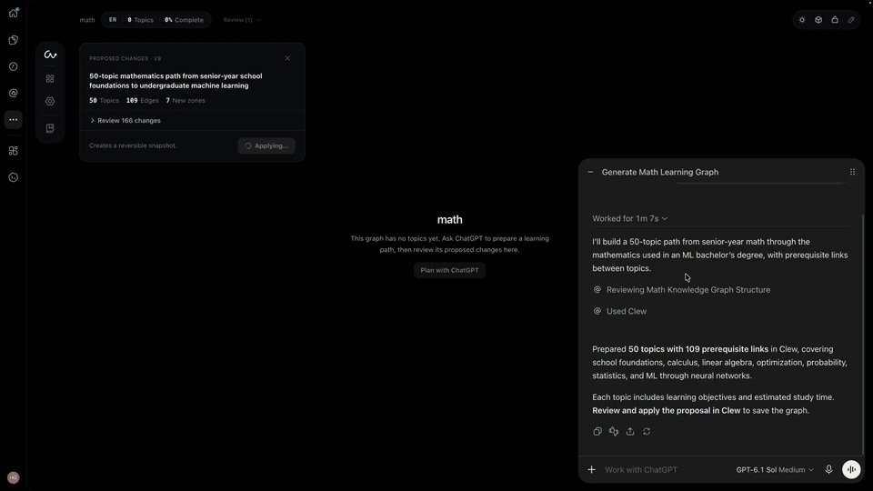

# Clew

[Try in ChatGPT](https://chatgpt.com/plugins/plugin_asdk_app_6ac57ed8716c8191a3405a8cea2a0d7e) · [Download desktop](https://github.com/miuuyy/Clew/releases/latest) · [Docs](https://clew.my/docs) · [Contributing](CONTRIBUTING.md) · [MIT](LICENSE)

**Generate a learning map. Click any topic. Follow the thread.**

[](https://github.com/miuuyy/Clew/raw/refs/heads/main/.github/readme-assets/chatgpt-demo.mp4)

[Watch the 45-second demo](https://github.com/miuuyy/Clew/raw/refs/heads/main/.github/readme-assets/chatgpt-demo.mp4) · Recorded in the ChatGPT plugin.

Start with what you know and what you want to learn. Clew turns that context into a graph of topics and prerequisites, so you can see what to study next and what stands between you and your goal.

Explore the map with AI, discuss a topic, find resources, and test what you have learned. When your goal changes, ask the assistant to extend or reshape your path. You review its proposed changes before applying them and can return to an earlier version.

## Try Clew

**[Open Clew in ChatGPT →](https://chatgpt.com/plugins/plugin_asdk_app_6ac57ed8716c8191a3405a8cea2a0d7e)**

Install the plugin, connect Clew, and tell ChatGPT what you want to learn. For example:

> I know basic algebra and want to build my first machine learning project. Create a learning path in Clew, including the foundations I am missing.

Your learning graph opens alongside the conversation. Select topics to explore their prerequisites and resources, discuss your next steps, and review suggested changes in place. Sign in to save your paths in a private workspace hosted by Clew.

Prefer a workspace on your own computer? The open-source desktop app stores your graphs locally and includes Obsidian import/export and a read-only MCP server for other assistants. Installation details are below.

## Why a graph?

A list of resources tells you what you could read. A learning path should also show why a topic matters and what it unlocks.

If you want to build a machine learning project, you may need a little Python, some algebra, and a way to evaluate your results. Clew makes those connections visible. Click a topic, follow its prerequisites, and keep your notes and progress attached to the path as you study.

## What you can do

- **Build a path around your goal.** Generate connected topics from what you already know and what you want to learn.
- **Follow the prerequisites.** Inspect the foundations behind a topic and see what remains before you can move on.
- **Study with AI.** Discuss topics, find learning resources, and ask questions in the context of your graph.
- **Check your understanding.** Practice with quizzes and keep track of your progress.
- **Keep control of your map.** Review AI proposals before applying them and restore earlier snapshots.
- **Bring your own notes on desktop.** Import an Obsidian vault, export Markdown or a graph, and share read-only context with other assistants through MCP.

## Install the desktop app

Download the build for your computer from [Releases](https://github.com/miuuyy/Clew/releases/latest).

| Platform | Builds |
| --- | --- |
| Windows | x64 installer |
| macOS 13+ | Apple Silicon and Intel, DMG or ZIP |
| Linux | x64 and arm64, AppImage or Debian package; see platform requirements |

Open Clew and select **Continue with ChatGPT**. The desktop app requires a ChatGPT **Plus or Pro** plan and permission to use that plan. You do not need Python, Node, an API key, or the Codex CLI installed.

GitHub stars and X follows are optional. They do not unlock features or change access.

The 1.0.0 downloads are not Developer ID notarized or Authenticode signed. macOS builds have an ad-hoc signature. See [installation notes](docs/DESKTOP.md) for platform requirements and data locations.

**Help → Check for Updates** opens the newer release's installer page. Updates are installed manually and retain local data.

### Work through a subject

1. Create a graph from your goal or import an Obsidian vault.
2. Select a topic to inspect its prerequisites, resources, and notes.
3. Ask the assistant to explain, quiz you, or expand the graph.
4. Review a proposal and apply it when the structure makes sense.
5. Finish a topic through the study workflow. Roll back a snapshot when needed.

The desktop app includes two graph views, Midnight and Paper themes, completion quizzes, Markdown and graph export, and a read-only MCP server for other assistants.

### Desktop privacy and control

- Graphs, snapshots, and conversation history are stored in a local SQLite database.
- ChatGPT credentials stay in the operating system's credential store.
- AI requests send the conversation and scoped learning context to OpenAI. They use your existing plan allowance.
- Set Clew's weekly allowance in **ChatGPT → Settings → Usage → App limits**.
- The model proposes changes. Clew validates them; you choose whether to apply them.
- Sign-out locks the workspace interface without deleting local data.

For the ChatGPT plugin's hosted workspace, see the [privacy policy](https://clew.my/app/privacy) and [terms](https://clew.my/app/terms).

## Development

Requirements: Node 22.22.2+, Python 3.11+, and an OS credential store.

```bash
git clone https://github.com/miuuyy/Clew.git
cd Clew
cp .env.example .env
./scripts/dev.sh
```

Open `http://127.0.0.1:5178`. The browser development build uses the same ChatGPT entry screen. To run the Electron app, install its tooling and start it:

```bash
npm ci
npm run dev
```

For native Windows setup and release builds, see [Desktop development](docs/DESKTOP.md).

```bash
npm run check:version
npm run test:desktop
npm --prefix frontend run typecheck
npm --prefix frontend run test
npm --prefix frontend run test:localization
npm --prefix frontend run build
PYTHONPATH=backend ./.venv/bin/python -m unittest discover -s backend/tests -v
```

## Source map

| Directory | Owns |
| --- | --- |
| `desktop/` | Electron lifecycle, local backend packaging, native builds and release checks |
| `frontend/src/` | Sign-in, graph workspace, proposal review and study UI |
| `backend/app/agent/` | ChatGPT authentication, Responses requests and typed tools |
| `backend/app/services/` | SQLite repository, snapshots, validation and grading |
| `contracts/` | Graph operation and proposal contracts |
| `docs/` | Engineering documentation |
| `docs/site_faq/` | Product documentation source |

Read [Architecture](docs/ARCHITECTURE.md) and [Project Context](docs/agents/PROJECT_CONTEXT.md) before changing product behavior.
