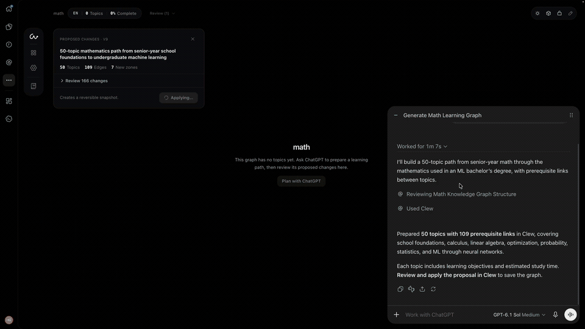

# Clew

[English](README.md) · [简体中文](README.zh-CN.md)

[在 ChatGPT 中试用](https://chatgpt.com/plugins/plugin_asdk_app_6ac57ed8716c8191a3405a8cea2a0d7e) · [下载桌面版](https://github.com/miuuyy/Clew/releases/latest) · [中文使用指南](docs/USAGE_GUIDE.zh-CN.md) · [参与贡献](CONTRIBUTING.md) · [MIT 许可证](LICENSE)

**围绕交互式知识图谱构建的 AI 学习工作区。**

[](https://github.com/miuuyy/Clew/raw/refs/heads/main/.github/readme-assets/chatgpt-demo.mp4)

[观看 45 秒演示](https://github.com/miuuyy/Clew/raw/refs/heads/main/.github/readme-assets/chatgpt-demo.mp4)。视频录制于 ChatGPT 插件。

告诉 Clew 你已经掌握了什么、想学到什么。它会整理主题和先修关系，再沿着这张图谱帮你学习。你可以在 ChatGPT 中使用 Clew，也可以使用开源桌面版。

## 在 ChatGPT 中试用

打开 [Clew 插件](https://chatgpt.com/plugins/plugin_asdk_app_6ac57ed8716c8191a3405a8cea2a0d7e)，连接后告诉 ChatGPT 你想学什么。例如：

> 我掌握了基础代数，想做第一个机器学习项目。请在 Clew 中用简体中文规划学习路径，并补上我缺少的基础。

学习图谱会显示在对话旁。登录后，可以将学习路径保存在由 Clew 托管的私人工作区。桌面版将图谱保存在你的电脑上。

## 如何使用

1. **确定起点和目标。** 告诉助手你已经学过什么、想学到哪里，也可以从自己的笔记开始。
2. **建立图谱。** 审阅建议添加的主题和先修关系，再将提案应用到图谱。点开任意主题可以查看先修路径。
3. **学习和练习。** 和助手讨论主题、查找资料、做测验，并在图谱中记录笔记和学习进度。
4. **按需调整。** 让助手扩展或调整学习路径。每次图谱变更由你确认，也可以恢复之前的快照。

桌面版支持导入 Obsidian 仓库、导出 Markdown 或 Clew 图谱包，以及通过 MCP 向其他助手提供只读的学习上下文。

## 安装桌面版

前往 [Releases](https://github.com/miuuyy/Clew/releases/latest) 下载对应的安装包。

| 平台 | 安装包 |
| --- | --- |
| Windows | x64 安装程序 |
| macOS 13 或更高版本 | Apple 芯片版和 Intel 版，提供 DMG 或 ZIP |
| Linux | x64 和 arm64，提供 AppImage 或 Debian 软件包 |

打开 Clew，选择 **使用 ChatGPT 继续**。桌面版需要 ChatGPT **Plus 或 Pro** 订阅，并需要你授权 Clew 使用订阅用量。无须安装 Python、Node 或 Codex CLI，也无须提供 API 密钥。GitHub 加星和关注 X 都是可选操作。

本仓库中的桌面版源码支持简体中文。你可以在登录界面切换语言，登录后也可以在 **设置 → 助手与工作区 → 界面语言** 中修改。如果已安装的版本还没有语言选项，可以运行本仓库的源码。

1.0.0 版的 macOS 安装包使用临时签名，未经过 Apple 公证。Windows 安装包未使用 Authenticode 签名。平台要求、更新方式和本地数据位置见[中文桌面安装指南](docs/DESKTOP.zh-CN.md)。

### 隐私和本地控制

- 图谱、快照和对话历史存储在本地 SQLite 数据库中。
- ChatGPT 登录凭据存储在操作系统的凭据管理器中。
- AI 请求会将本次对话和相关的学习信息发送给 OpenAI，使用你现有订阅的用量。
- 在 **ChatGPT → 设置 → 用量 → 应用限额** 中，可以为 Clew 设置每周用量上限。
- 助手提出图谱变更，由 Clew 验证，再由你决定是否应用。退出登录会锁定工作区界面，本地数据仍会保留。

ChatGPT 插件托管工作区的政策见[隐私政策](https://clew.my/app/privacy)和[使用条款](https://clew.my/app/terms)。

## 开发

需要 Node 22.22.2+、Python 3.11+ 和系统凭据管理器。

```bash
git clone https://github.com/miuuyy/Clew.git
cd Clew
cp .env.example .env
./scripts/dev.sh
```

打开 `http://127.0.0.1:5178`。浏览器开发版使用同一个 ChatGPT 登录流程。安装工具后也可以运行 Electron 应用：

```bash
npm ci
npm run dev
```

Windows 环境配置和发布构建见[桌面安装指南](docs/DESKTOP.zh-CN.md)。

```bash
npm run check:version
npm run test:desktop
npm --prefix frontend run typecheck
npm --prefix frontend run test
npm --prefix frontend run test:localization
npm --prefix frontend run build
PYTHONPATH=backend ./.venv/bin/python -m unittest discover -s backend/tests -v
```

## 源码目录

| 目录 | 内容 |
| --- | --- |
| `desktop/` | Electron 启动与退出、后端打包、各平台构建和发布验证 |
| `frontend/src/` | 登录、图谱工作区、提案审阅和学习界面 |
| `backend/app/agent/` | ChatGPT 登录、Responses 请求和助手工具 |
| `backend/app/services/` | SQLite 数据存储、快照、提案验证和测验评分 |
| `contracts/` | 图谱操作与提案的数据契约 |
| `docs/` | 工程文档 |
| `docs/site_faq/` | 产品文档源码 |

了解产品边界和关键技术决策，可阅读[架构](docs/ARCHITECTURE.md)和[项目背景](docs/agents/PROJECT_CONTEXT.md)。
